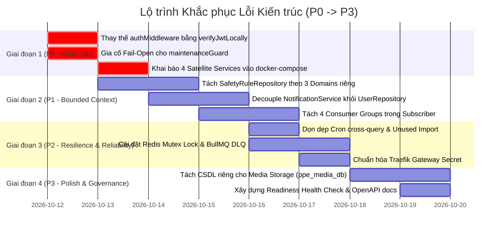

# Báo cáo Kiểm toán Kiến trúc & Kế hoạch Khắc phục Vi phạm (P0 - P3)

> **Phiên bản:** 1.0.0  
> **Ngày lập:** 12/10/2026  
> **Tài liệu đối chiếu:**  
> - `docs/architecture/database-ownership.md`  
> - `docs/architecture/migration-backlog.md`  
> - `docs/architecture/module-communication-audit.md`  
> - `docs/architecture/runtime-flows.md`  
> **Mục tiêu:** Phân tích, đánh giá hiện trạng 4 tài liệu kiến trúc so với mã nguồn thực tế (`src/`, `traefik/`, `docker-compose.yml`), tổng hợp toàn bộ các lỗi kiến trúc, bảo mật, vận hành và phân cấp giải pháp khắc phục từ **P0 đến P3**.

---

## 1. Đánh giá & Nhận xét Tổng quan về 4 Tài liệu Kiến trúc

### 1.1. Ưu điểm nổi bật
1. **Thiết kế theo chuẩn Microservices Database-per-Service hiện đại:**
   - Phân định rõ 6 cơ sở dữ liệu vật lý/logic (`ppe_identity_db`, `ppe_site_db`, `ppe_camera_db`, `ppe_incident_db`, `ppe_notification_db`, `ppe_reporting_db`).
   - Ranh giới nghiệp vụ (Bounded Contexts) được định nghĩa mạch lạc, phân rõ trách nhiệm của 9 tiến trình độc lập (Core API, Background Worker, và 6 Satellite Microservices).
2. **Cơ chế Bảo mật & Giao tiếp phân tán tiên tiến:**
   - Sử dụng **RS256 Decentralized JWT Verification** với JWKS endpoint và RAM caching 24h, loại bỏ việc satellite services phải gọi HTTP ngược về Auth Service để xác thực từng request.
   - Luồng bảo vệ Webhook Inbound chặt chẽ (Anti-replay timestamp window 300s, chữ ký HMAC-SHA256, Idempotency SETNX 24h).
   - Quản lý trạng thái bảo trì thời gian thực thông qua Redis Pub/Sub Cache Invalidation.
3. **Mô hình Hàng đợi & Background Worker bài bản:**
   - Ứng dụng BullMQ với Repeatable Jobs và Distributed Locks chống chạy trùng lặp khi worker scale ngang.
   - Event-driven Fan-out Pub/Sub phân chia rõ 4 Consumer Groups (`INCIDENT_SERVICE`, `NOTIFICATION_SERVICE`, `REPORTING_SERVICE`, `AUDIT_LOGGER`) để xử lý sự kiện vi phạm PPE từ AI Camera.

---

### 1.2. Khoảng cách & Mâu thuẫn giữa Tài liệu và Mã nguồn Thực tế

Dù tài liệu kiến trúc được thiết kế rất hoàn chỉnh, việc đối soát mã nguồn (`src/`) đã phát hiện các điểm xung đột và tàn dư monolith nghiêm trọng:

| Hạng mục kiến trúc | Mô tả trong Tài liệu (`/docs/architecture`) | Hiện trạng thực tế trong Source Code | Đánh giá rủi ro |
| :--- | :--- | :--- | :--- |
| **Decentralized Auth** | Satellite services tự xác thực JWT offline bằng public key RS256 (`runtime-flows.md` mục 3.1). | Các router satellite (`site.route.ts`, `camera.route.ts`, `incident.route.ts`) vẫn dùng `authMiddleware`. Middleware này gọi `permissionCacheService.getUserState()` query trực tiếp `ppe_identity_db`. | **Cực kỳ nguy hiểm (P0)**: Nếu Identity DB sập, toàn bộ Satellite Services đều bị 401 Unauthorized. |
| **Bảo trì Hệ thống** | Khi bảo trì, cập nhật Redis Pub/Sub và bypass nhanh chóng (`runtime-flows.md` mục 2). | `maintenanceGuard()` gọi `maintenanceCacheService.getConfig()`. Khi hết cache RAM, service fallback query `prisma.maintenanceConfig` (`ppe_identity_db`). | **Cực kỳ nguy hiểm (P0)**: Biến Identity DB thành SPOF làm sập mọi request satellite. |
| **Deploy Docker** | Hệ thống định tuyến qua Traefik tới 6 satellite microservices (`module-communication-audit.md`). | `docker-compose.yml` **chưa khai báo** 4 service container (`site-service`, `camera-service`, `incident-service`, `reporting-service`). Traefik dynamic trỏ vào `host.docker.internal`. | **Khẩn cấp (P0)**: Không thể khởi chạy hệ thống microservices hoàn chỉnh trên Docker Linux/VPS. |
| **Database Isolation** | Mỗi service chỉ kết nối vào đúng CSDL của mình (`database-ownership.md`). | `SafetyRuleRepository` import trực tiếp 4 Prisma clients (`sitePrisma`, `cameraPrisma`, `reportingPrisma`, `identityPrisma`). | **Nghiêm trọng (P1)**: Phá vỡ nguyên lý Database-per-Service. |
| **Notification Recipients** | Notification Service chạy độc lập trên port `:8889` với DB riêng. | `NotificationService.dispatchIncidentNotification` gọi trực tiếp `UserRepository` (`ppe_identity_db`). | **Nghiêm trọng (P1)**: Rò rỉ coupling dữ liệu giữa Notification và Identity. |
| **Media Database** | Media Service hoạt động tại `:8890`. | Bảng `file_records` vẫn nằm trong `schema.prisma` (`ppe_identity_db`), chưa có schema và database riêng. | **Cần hoàn thiện (P3)**. |

---

## 2. Bảng Phân loại Mức độ Ưu tiên (Severity Matrix)

- **P0 (Critical / Blocker):** Lỗi làm sập dây chuyền (Cascading Failure), điểm nghẽn đơn lẻ (SPOF) làm tê liệt hệ thống, hoặc lỗi ngăn cản việc deploy/khởi chạy dịch vụ. **Bắt buộc xử lý ngay lập tức.**
- **P1 (High / Architecture Violation):** Vi phạm ranh giới dịch vụ (Bounded Context), liên kết CSDL chéo (Cross-DB query), coupling trực tiếp giữa các domain làm mất tính độc lập của microservices.
- **P2 (Medium / Resilience & Reliability):** Lỗi ảnh hưởng đến độ tin cậy khi có sự cố, thiếu cơ chế Dead Letter Queue, sai lệch cấu hình môi trường giữa Gateway và Service.
- **P3 (Low / Polish & Governance):** Tối ưu hóa cấu trúc mã nguồn, dọn dẹp import thừa, hoàn thiện schema CSDL riêng biệt cho Media và tài liệu hóa OpenAPI.

---

## 3. Danh mục Chi tiết Lỗi & Phương án Khắc phục

```
┌────────────────────────────────────────────────────────────────────────┐
│                               PHÂN CẤP LỖI                             │
├───────────────┬────────────────────────────────────────────────────────┤
│  MỨC ĐỘ P0    │ 3 Lỗi Blockers & Sập dây chuyền (Auth, Maintenance,    │
│  (CRITICAL)   │ Docker Compose)                                        │
├───────────────┼────────────────────────────────────────────────────────┤
│  MỨC ĐỘ P1    │ 3 Lỗi Vi phạm Kiến trúc Bounded Context & Cross-DB     │
│  (HIGH)       │ (SafetyRuleRepo, NotificationService, Subscriber)      │
├───────────────┼────────────────────────────────────────────────────────┤
│  MỨC ĐỘ P2    │ 4 Lỗi Độ tin cậy, Hàng đợi & Gateway Config           │
│  (MEDIUM)     │ (CronRepo, Unused Client, DLQ/Mutex, Gateway Secret)   │
├───────────────┼────────────────────────────────────────────────────────┤
│  MỨC ĐỘ P3    │ 3 Hạng mục Hoàn thiện Kiến trúc & Tài liệu             │
│  (LOW)        │ (Media DB Split, Swagger Aggregate, Deep Healthcheck)  │
└───────────────┴────────────────────────────────────────────────────────┘
```

---

### MỨC ĐỘ P0: LỖI KHẨN CẤP & CASCADING FAILURE

#### ISSUE-P0-01: Cascading Outage do Satellite Services phụ thuộc `authMiddleware` truy vấn `ppe_identity_db`
- **Vị trí phát hiện:**  
  - `src/middlewares/auth.middleware.ts` (Dòng 131–142)
  - `src/modules/site/site.route.ts` (Dòng 3, 30, 38...)
  - `src/modules/camera/camera.route.ts`
  - `src/modules/incident/incident.route.ts`
  - `src/modules/reporting/reporting.route.ts`
- **Nguyên nhân kỹ thuật:**  
  Các router của các satellite microservice hiện đang import và gắn `authMiddleware`. Trong `authMiddleware`, sau khi giải mã JWT, code bắt buộc gọi:
  ```typescript
  const userState = await permissionCacheService.getUserState(payload.id);
  if (!userState || !userState.isActive || userState.deletedAt) {
    next(new AppError("Tài khoản của bạn đã bị vô hiệu hóa hoặc không tồn tại", 401, ERROR_CODE.UNAUTHORIZED));
    return;
  }
  ```
  Hàm `permissionCacheService.getUserState` lại gọi trực tiếp `userRepository.findUserStateById`, kết nối thẳng vào `identityPrisma` (`ppe_identity_db`).  
- **Hậu quả vận hành:**  
  Mặc dù satellite service có DB riêng và có public key RS256, nhưng nếu CSDL Identity (`ppe_identity_db`) gặp sự cố (quá tải kết nối, restart, network timeout), **tất cả mọi request người dùng gửi tới Site, Camera, Incident, Reporting đều lập tức bị trả về lỗi 401 Unauthorized**. Điều này phá hủy hoàn toàn mục tiêu độc lập (Fault Isolation) của hệ thống vi dịch vụ.
- **Giải pháp khắc phục:**  
  1. Thay thế toàn bộ `authMiddleware` tại các satellite routes bằng middleware **`verifyJwtLocally`** (đã có sẵn tại `src/middlewares/verify-jwt-locally.middleware.ts`).
  2. Middleware `verifyJwtLocally` tự đọc RSA Public Key từ RAM cache hoặc `keys/public.pem` và kiểm tra chữ ký RS256 nội bộ trong 0.01ms mà **không gọi bất kỳ CSDL hay API bên ngoài nào**.
  3. Để kiểm tra trạng thái vô hiệu hóa tài khoản (User Revocation), chuyển sang cơ chế **Redis Token Blocklist / User Revocation Cache**:
     - Khi Admin khóa user hoặc đổi mật khẩu, Identity Service bắn message `USER_REVOKED` qua Redis Pub/Sub.
     - Các satellite service lưu `revokedUserIds` vào Redis Set hoặc In-Memory Set để kiểm tra nhanh. Nếu Redis không khả dụng, áp dụng chiến lược **Fail-Open an toàn** cho đến khi token hết hạn (15 phút).
- **Code mẫu khắc phục:**
  ```typescript
  // Trong src/modules/site/site.route.ts
  - import { authMiddleware } from "../../middlewares/auth.middleware";
  + import { verifyJwtLocally } from "../../middlewares/verify-jwt-locally.middleware";

  // Thay thế tại các router endpoints:
  siteRouter.get(
    "/",
  - authMiddleware,
  + verifyJwtLocally,
    requirePermission(PERMISSIONS.PPE_SITE_READ),
    validate(siteQuerySchema, "query"),
    siteController.findAllSites,
  );
  ```

---

#### ISSUE-P0-02: Single Point of Failure (SPOF) do `maintenanceGuard()` làm sập Satellite Services khi mất kết nối `ppe_identity_db`
- **Vị trí phát hiện:**  
  - `src/middlewares/maintenance.middleware.ts` (Dòng 40, 101)
  - `src/common/services/maintenance-cache.service.ts` (Dòng 101)
  - `src/modules/maintenance/maintenance.repository.ts` (Dòng 13–26)
  - Tất cả các app entry points: `site.app.ts`, `camera.app.ts`, `incident.app.ts`, `reporting.app.ts`.
- **Nguyên nhân kỹ thuật:**  
  Tất cả các satellite services đều sử dụng middleware `maintenanceGuard()` trước các router. Hàm này gọi `maintenanceCacheService.getConfig()`. Khi entry RAM cache hết hạn (TTL 5 phút):
  ```typescript
  const config = await maintenanceRepository.getOrCreateDefaultConfig(key);
  ```
  `maintenanceRepository` truy vấn trực tiếp bảng `maintenance_configs` trong `identityPrisma` (`ppe_identity_db`). Nếu `ppe_identity_db` không khả dụng hoặc container satellite không có chuỗi kết nối tới identity db, một ngoại lệ unhandled exception sẽ bị ném ra, đẩy qua `errorMiddleware` và trả về lỗi `500/503 Internal Server Error` cho toàn bộ request.
- **Hậu quả vận hành:**  
  Một sự cố tạm thời tại Identity Database sẽ kéo sập tính khả dụng của toàn bộ hệ sinh thái vệ tinh (Site, Camera, Incident).
- **Giải pháp khắc phục:**  
  1. Thêm **Circuit Breaker / Resilient Fallback** vào `MaintenanceCacheService`:
     - Nếu truy vấn DB/Redis thất bại, bắt ngoại lệ (catch) và trả về đối tượng cấu hình mặc định trong bộ nhớ RAM (`DEFAULT_MAINTENANCE_CONFIG` với `enabled = false, status = "ONLINE"`).
     - Không bao giờ để lỗi kết nối cấu hình bảo trì làm gián đoạn luồng xử lý chính của satellite service.
  2. Bỏ qua việc gọi `permissionCacheService.getUserState()` bên trong `maintenanceGuard` đối với các satellite microservices; thay vào đó chỉ kiểm tra role `ADMIN` được gắn sẵn trong payload của RS256 JWT claims.
- **Code mẫu khắc phục:**
  ```typescript
  // Trong src/common/services/maintenance-cache.service.ts
  async getConfig(key = "DEFAULT"): Promise<MaintenanceConfig> {
    const now = Date.now();
    if (this.cache && now < this.cache.expiresAt) {
      return this.cache.config;
    }

    try {
      const config = await maintenanceRepository.getOrCreateDefaultConfig(key);
      this.cache = { config, expiresAt: now + this.TTL_MS };
      return config;
    } catch (err: any) {
      console.warn("[MaintenanceCacheService] Fallback to default memory config:", err.message);
      // Fallback an toàn (Fail-Open): Không sập service khi mất kết nối Identity DB
      return {
        id: "default",
        key,
        enabled: false,
        status: "ONLINE",
        title: "Bảo trì hệ thống",
        message: "Hệ thống đang hoạt động bình thường",
        bypassPermissions: ["MAINTENANCE_MANAGE", "MAINTENANCE_BYPASS"],
        bypassRoles: ["ADMIN"],
        bypassIps: [],
        startAt: null,
        estimatedEndAt: null,
        createdAt: new Date(),
        updatedAt: new Date(),
      } as unknown as MaintenanceConfig;
    }
  }
  ```

---

#### ISSUE-P0-03: Deployment Failure trên Docker & Container Orchestration do thiếu 4 Microservices trong `docker-compose.yml`
- **Vị trí phát hiện:**  
  - `docker-compose.yml` (Dòng 19–282)
  - `traefik/dynamic.yml` (Dòng 153–188)
- **Nguyên nhân kỹ thuật:**  
  - Trong `docker-compose.yml`, chỉ mới khai báo 4 container: `app-api` (:9999), `app-worker`, `notification-service` (:8889), `media-service` (:8890).
  - Hoàn toàn **chưa có service definitions** cho: `site-service` (:8891), `camera-service` (:8892), `incident-service` (:8893), `reporting-service` (:8894).
  - Cấu hình Traefik `dynamic.yml` hiện tại đang hard-code trỏ vào:
    ```yaml
    site-service:
      loadBalancer:
        servers:
          - url: "http://host.docker.internal:8891"
    ```
- **Hậu quả vận hành:**  
  Khi chạy `docker compose up` trên môi trường Linux Server hoặc production VPS:
  1. 4 service vệ tinh không hề được Docker build và run.
  2. Traefik cố gắng kết nối tới `host.docker.internal:8891-8894` và lập tức trả về **`502 Bad Gateway`** cho mọi request người dùng gửi tới `/api/v1/sites`, `/api/v1/cameras`, `/api/v1/incidents`, `/api/v1/reports`.
- **Giải pháp khắc phục:**  
  1. Bổ sung đầy đủ 4 container definitions vào `docker-compose.yml` (`site-service`, `camera-service`, `incident-service`, `reporting-service`), dùng chung network `internal_net` và chỉ định command chạy đúng file bundle tương ứng (`dist/site.server.js`, `dist/camera.server.js`, v.v.).
  2. Gắn Traefik Docker labels trực tiếp trên từng service để Traefik tự động Service Discovery qua Docker Socket, loại bỏ hoàn toàn sự phụ thuộc vào `host.docker.internal`.
- **Code mẫu khai báo bổ sung trong `docker-compose.yml`:**
  ```yaml
  # ── Layer 2e: Site Microservice (:8891) ──────────────────────────────────
  site-service:
    build:
      context: .
      dockerfile: Dockerfile
    container_name: site_service
    restart: unless-stopped
    env_file: [.env]
    environment:
      NODE_ENV: "${NODE_ENV:-production}"
      PORT: "${SITE_PORT:-8891}"
      SITE_DATABASE_URL: "${SITE_DATABASE_URL}"
      REDIS_URL: ""
      REDIS_HOST: redis
      REDIS_PORT: "6379"
      REDIS_PASSWORD: "${REDIS_PASSWORD:-}"
      TRUST_PROXY: "1"
      GATEWAY_INTERNAL_SECRET: "${GATEWAY_INTERNAL_SECRET:-}"
    volumes:
      - ./keys:/app/keys:ro
    expose: ["${SITE_PORT:-8891}"]
    depends_on:
      redis: { condition: service_healthy }
      traefik: { condition: service_healthy }
    networks: [internal_net]
    command: ["node", "dist/site.server.js"]
    labels:
      - "traefik.enable=true"
      - "traefik.docker.network=internal_net"
      - "traefik.http.routers.sites.rule=PathPrefix(`/api/v1/sites`) || PathPrefix(`/api/v1/zones`) || PathPrefix(`/api/v1/restricted-areas`) || PathPrefix(`/api/v1/safety-rules`)"
      - "traefik.http.routers.sites.priority=100"
      - "traefik.http.routers.sites.entrypoints=web,websecure"
      - "traefik.http.services.sites.loadbalancer.server.port=${SITE_PORT:-8891}"
      - "traefik.http.services.sites.loadbalancer.healthcheck.path=/health"
      - "traefik.http.routers.sites.middlewares=security-headers@file,global-ratelimit@file,request-id@file,inject-gateway-secret"
  ```
  *(Thực hiện tương tự cho `camera-service`, `incident-service`, `reporting-service`)*.

---

### MỨC ĐỘ P1: LỖI VI PHẠM KIẾN TRÚC & DATA COUPLING

#### ISSUE-P1-01: `SafetyRuleRepository` vi phạm Database-per-Service khi truy vấn trực tiếp 4 Cơ sở dữ liệu
- **Vị trí phát hiện:**  
  - `src/modules/safety-rule/safety-rule.repository.ts` (Dòng 1–25, 169–225, 256–281)
- **Nguyên nhân kỹ thuật:**  
  Lớp `SafetyRuleRepository` import trực tiếp 4 Prisma clients:
  ```typescript
  import { sitePrisma } from "../../database/site.client";
  import { cameraPrisma } from "../../database/camera.client";
  import { reportingPrisma } from "../../database/reporting.client";
  import { rbacRepository } from "../rbac/rbac.repository"; // Dùng identityPrisma
  ```
  - `findActiveModelVersion` query bảng `ai_model_versions` thuộc `ppe_reporting_db`.
  - `findCameraById`, `upsertCameraSafetyConfig` query `ppe_camera_db`.
  - `recordAuditLog` gọi `rbacRepository.createAuditLog` ghi vào `ppe_identity_db`.
- **Hậu quả vận hành:**  
  Để chạy module Safety Rule trong `site.server.ts` (:8891), service này bắt buộc phải nạp và giữ kết nối connection pool tới **cả 4 CSDL khác nhau**. Nếu một CSDL trong số đó bị ngắt kết nối, các hàm cấu hình của site có nguy cơ bị lỗi.
- **Giải pháp khắc phục:**  
  1. Phân chia lại trách nhiệm (Decoupling):
     - **Site Domain:** Chỉ quản lý `site_safety_configs` và `restricted_areas` trong `ppe_site_db`.
     - **Camera Domain:** Quản lý `camera_configs` trong `ppe_camera_db`. Tách method cấu hình camera sang `camera.repository.ts`.
     - **Reporting Domain:** Quản lý `ai_model_versions` trong `ppe_reporting_db`.
  2. Giao tiếp liên dịch vụ:
     - Khi Site Service cần validate `modelVersionId`: Sử dụng HTTP Call nội bộ `GET http://reporting-service:8894/api/v1/ai-models/versions/:id` kèm bộ nhớ đệm RAM (TTL 1 giờ), hoặc nhận event Pub/Sub khi có model mới được deploy.
     - Với Audit Log: Bắn event `system.audit.created` lên Redis EventBus để `app-worker` ghi nhận vào `ppe_identity_db`, không gọi trực tiếp `rbacRepository`.

---

#### ISSUE-P1-02: `NotificationService` liên kết chéo trực tiếp (Tight Coupling) với `UserRepository` (`ppe_identity_db`)
- **Vị trí phát hiện:**  
  - `src/modules/notification/notification.service.ts` (Dòng 27, 51, 64)
- **Nguyên nhân kỹ thuật:**  
  `NotificationService` chịu trách nhiệm xử lý thông báo tại tiến trình `:8889` (`ppe_notification_db`), nhưng khi có sự cố cần thông báo (`dispatchIncidentNotification`), service này lại import trực tiếp:
  ```typescript
  import { userRepository, UserRepository } from "../users/user.repository";
  ```
  Hàm này query trực tiếp bảng `users` trong `ppe_identity_db` để lấy danh sách email và số điện thoại của quản trị viên và giám sát viên.
- **Hậu quả vận hành:**  
  `notification-service` không thể hoạt động độc lập thực sự nếu không có connection string trực tiếp tới `ppe_identity_db`.
- **Giải pháp khắc phục:**  
  1. Áp dụng mô hình **Event Payload Enrichment**: Khi sự kiện sự cố vi phạm được phát ra (`ppe.violation.detected` hoặc `ppe.incident.created`), phía phát sự kiện hoặc một aggregator service đính kèm sẵn thông tin context người nhận, HOẶC:
  2. Bổ sung bảng cục bộ **`notification_recipients`** trong `ppe_notification_db`. Bảng này lưu trữ bản sao tối thiểu (projection) `{ userId, email, role, siteId, isActive }` được đồng bộ thời gian thực qua Redis Pub/Sub mỗi khi có sự kiện `user.created`, `user.updated`, `user.deleted`.

---

#### ISSUE-P1-03: Monolith Worker Dependency trong `ppe-violation.subscriber.ts` kết nối đồng thời cả 4 Cơ sở dữ liệu
- **Vị trí phát hiện:**  
  - `src/common/subscribers/ppe-violation.subscriber.ts` (Dòng 16–34)
- **Nguyên nhân kỹ thuật:**  
  File `ppe-violation.subscriber.ts` đóng gói toàn bộ logic xử lý vi phạm trong một class duy nhất và import:
  - `IncidentRepository` (`ppe_incident_db`)
  - `NotificationService` (`ppe_notification_db`)
  - `ReportingRepository` (`ppe_reporting_db`)
  - `AuditService` (`ppe_identity_db`)
  Khi `worker.server.ts` chạy, tiến trình worker này phải duy trì cùng lúc 4 kết nối Prisma Client.
- **Hậu quả vận hành:**  
  Mất tính cô lập lỗi (Fault Isolation). Nếu tác vụ tạo báo cáo của `ReportingRepository` bị tràn bộ nhớ hoặc lock database, luồng ghi nhận sự cố (`IncidentRepository`) có thể bị chậm trễ hoặc ảnh hưởng lây lan.
- **Giải pháp khắc phục:**  
  Tách `ppe-violation.subscriber.ts` thành 4 worker subscriber độc lập tương ứng với 4 Consumer Groups:
  1. `IncidentViolationConsumer` (chỉ import `IncidentRepository`).
  2. `NotificationViolationConsumer` (chỉ import `NotificationService`).
  3. `ReportingViolationConsumer` (chỉ import `ReportingRepository`).
  4. `AuditViolationConsumer` (chỉ import `AuditService`).
  Mỗi subscriber có thể được chạy trên các worker process chuyên biệt hoặc container độc lập.

---

### MỨC ĐỘ P2: LỖI ĐỘ TIN CẬY, RESILIENCE & QUẢN TRỊ VẬN HÀNH

#### ISSUE-P2-01: `CronRepository` cross-query `ppe_notification_db` để tính thống kê hoạt động
- **Vị trí phát hiện:**  
  - `src/modules/cron/cron.repository.ts` (Dòng 3, 102–119)
- **Nguyên nhân kỹ thuật:**  
  Trong hàm `getActivityStats()`, `CronRepository` sử dụng `notificationPrisma` để đếm số lượng thông báo:
  ```typescript
  const [notifs, emails] = await Promise.all([
    notificationPrisma.notification.count(...),
    notificationPrisma.emailNotification.count(...),
  ]);
  ```
- **Hậu quả vận hành:**  
  Vi phạm ranh giới CSDL giữa Identity Worker và Notification Database.
- **Giải pháp khắc phục:**  
  - Thay vì query trực tiếp CSDL của Notification, Cron Service gọi HTTP nội bộ tới `GET http://notification-service:8889/api/v1/notifications/stats` hoặc lấy chỉ số thống kê đã được `ReportingService` tổng hợp định kỳ.

---

#### ISSUE-P2-02: Unused Import `identityPrisma` trong `notification.repository.ts` gây rò rỉ dependency
- **Vị trí phát hiện:**  
  - `src/modules/notification/notification.repository.ts` (Dòng 9)
- **Nguyên nhân kỹ thuật:**  
  Dòng 9 của file chứa:
  ```typescript
  import { prisma as identityPrisma } from "../../database/prisma.client";
  ```
  Nhưng biến `identityPrisma` hoàn toàn không được sử dụng ở bất kỳ dòng code nào trong repository này.
- **Hậu quả:**  
  Làm mã nguồn bị coupling giả tạo, khiến bundler và runtime của Notification Service vô tình nạp Prisma Client của Identity DB vào bộ nhớ, gây lãng phí tài nguyên và tạo hiểu lầm về ranh giới sở hữu CSDL.
- **Giải pháp khắc phục:**  
  Xóa bỏ dòng import thừa này khỏi file.

---

#### ISSUE-P2-03: Thiếu Dead Letter Queue (DLQ) tập trung và Mutex Lock phân tán cho Event Processing
- **Vị trí phát hiện:**  
  - `src/common/subscribers/ppe-violation.subscriber.ts` (Dòng 143–153, 157–171)
- **Nguyên nhân kỹ thuật:**  
  - Biến mutex lock `lock = this.reliability.checkAndAcquireIdempotency(...)` đang sử dụng bộ nhớ in-process của `ReliabilityService` (RAM của worker hiện tại). Khi scale nhiều worker containers, hai worker khác nhau sẽ không chia sẻ được mutex lock này, dẫn tới nguy cơ xử lý trùng lặp (Race Condition).
  - Khi `executeWithRetry` vượt quá số lần thử lại tối đa (maxRetries = 3), sự kiện bị drop và chỉ ghi log lỗi, chưa có Dead Letter Queue (DLQ) chuyên dụng trên Redis để kỹ sư vận hành có thể inspect và replay lại sự kiện.
- **Giải pháp khắc phục:**  
  1. Chuyển Mutex Lock của `ReliabilityService` sang dùng lệnh nguyên tử **Redis `SETNX` với TTL 30 giây**.
  2. Bổ sung cơ chế đẩy payload lỗi vào BullMQ Dead Letter Queue (`bullmq-ppe-violation-dlq`) kèm theo stack trace để phục vụ việc đối soát và xử lý bù.

---

#### ISSUE-P2-04: Sai lệch cấu hình Gateway Secret giữa `traefik/dynamic.yml` và biến môi trường Docker
- **Vị trí phát hiện:**  
  - `traefik/dynamic.yml` (Dòng 45)
  - `docker-compose.yml` (Dòng 133)
- **Nguyên nhân kỹ thuật:**  
  Trong `traefik/dynamic.yml`, middleware `inject-gateway-secret` có giá trị:
  ```yaml
  inject-gateway-secret:
    headers:
      customRequestHeaders:
        X-Gateway-Secret: "PLACEHOLDER_REPLACE_AT_DEPLOY"
  ```
  Trong khi `docker-compose.yml` lại inject biến `${GATEWAY_INTERNAL_SECRET}` thông qua Docker labels. Nếu Traefik đọc cấu hình từ file dynamic thay vì labels, header `x-gateway-secret` sẽ mang giá trị placeholder, dẫn tới việc request bị các microservice từ chối (403 Forbidden).
- **Giải pháp khắc phục:**  
  Loại bỏ định nghĩa trùng lặp trong `traefik/dynamic.yml`, chuẩn hóa việc inject biến `X-Gateway-Secret` thông qua Docker Compose labels hoặc Traefik environment variables.

---

### MỨC ĐỘ P3: HOÀN THIỆN KIẾN TRÚC & TÀI LIỆU

#### ISSUE-P3-01: Chưa phân tách CSDL riêng cho Media & Evidence Storage (`ppe_media_db`)
- **Vị trí phát hiện:**  
  - `prisma/schema.prisma` (Bảng `FileRecord`)
  - `src/media.server.ts` (:8890)
- **Nguyên nhân kỹ thuật:**  
  Media Service đã được tách thành một tiến trình chạy độc lập tại port `:8890`, tuy nhiên bảng lưu trữ thông tin tệp `FileRecord` vẫn nằm trong CSDL chung `ppe_identity_db`.
- **Giải pháp khắc phục:**  
  1. Tạo thư mục schema riêng: `prisma/media/schema.prisma`.
  2. Định nghĩa model `FileRecord` và cấu hình connection string `MEDIA_DATABASE_URL` trỏ tới CSDL `ppe_media_db`.
  3. Sinh client độc lập `@prisma/client-media` và chuyển `file.repository.ts` sang sử dụng client này.

---

#### ISSUE-P3-02: Thiếu tài liệu OpenAPI/Swagger độc lập và cơ chế Swagger Aggregation tại API Gateway
- **Vị trí phát hiện:**  
  - `src/api.server.ts` (Mount `/api/docs`)
  - Các satellite services: `site.server.ts`, `camera.server.ts`, `incident.server.ts`, `reporting.server.ts`.
- **Nguyên nhân kỹ thuật:**  
  Hiện tại Swagger UI chỉ được nạp tại `app-api` (:9999). Các developer phát triển client hoặc AI Edge camera khi kết nối vào các port độc lập không có endpoint tài liệu kỹ thuật trực tiếp.
- **Giải pháp khắc phục:**  
  1. Mỗi satellite service cung cấp endpoint `/docs/openapi.json`.
  2. Tại API Gateway (`app-api` hoặc Traefik), cấu hình Swagger UI đa nguồn (Multi-spec dropdown), cho phép người dùng xem OpenAPI docs của tất cả các microservices tại một giao diện tập trung duy nhất (`/api/docs`).

---

#### ISSUE-P3-03: Thiếu Deep Health Check kiểm tra tính sẵn sàng của Database & Redis
- **Vị trí phát hiện:**  
  - Các endpoint `/health` tại `site.app.ts`, `camera.app.ts`, `incident.app.ts`.
- **Nguyên nhân kỹ thuật:**  
  Hàm health handler hiện tại chỉ trả về dữ liệu tĩnh:
  ```typescript
  res.status(200).json({ status: "ok", uptime: process.uptime() });
  ```
  Nếu kết nối CSDL bị đứt hoặc Redis bị sập, endpoint `/health` vẫn trả về `200 OK`, khiến Traefik tiếp tục chuyển tiếp traffic vào một service không có khả năng xử lý dữ liệu.
- **Giải pháp khắc phục:**  
  Tách thành 2 probe chuẩn Kubernetes/Docker:
  - **Liveness Probe (`/healthz` hoặc `/health/live`):** Kiểm tra tiến trình Node.js còn sống hay không.
  - **Readiness Probe (`/ready` hoặc `/health/ready`):** Thực hiện `prisma.$queryRaw\`SELECT 1\`` và `redis.ping()`. Nếu không kết nối được, trả về `503 Service Unavailable` để Traefik tự động ngắt tải.

---

## 4. Lộ trình Thực hiện Khắc phục (Remediation Roadmap)



---

## 5. Tiêu chuẩn Nghiệm thu & Kiểm thử (Verification Criteria)

1. **Kiểm thử Cách ly Sự cố (Fault Isolation Test):**
   - Tắt CSDL `ppe_identity_db`.
   - Gửi request `GET /api/v1/sites` và `GET /api/v1/cameras` kèm JWT hợp lệ.
   - **Kỳ vọng:** Request thành công 200 OK với độ trễ < 20ms nhờ `verifyJwtLocally` và `maintenanceGuard` fallback an toàn, không bị 401 hay 503.
2. **Kiểm thử Docker Microservices Deployment:**
   - Chạy lệnh `docker compose up -d`.
   - Kiểm tra lệnh `docker ps` thấy đầy đủ 8 containers hoạt động lành mạnh (`healthy`).
   - Gửi request qua Traefik port 80/443 tới toàn bộ các prefix route (`/api/v1/sites`, `/api/v1/cameras`, `/api/v1/incidents`, `/api/v1/notifications`, `/api/v1/reports`). Tất cả đều nhận phản hồi chính xác, không có lỗi 502 Bad Gateway.
3. **Kiểm thử Bounded Context & DB Connection Limits:**
   - Kiểm tra log kết nối của từng container.
   - Container `site-service` chỉ mở connection tới duy nhất `ppe_site_db`.
   - Container `camera-service` chỉ mở connection tới duy nhất `ppe_camera_db`.
   - Container `incident-service` chỉ mở connection tới duy nhất `ppe_incident_db`.

---

## 6. Kết quả Kiểm tra & Nghiệm thu Thực tế (Verification Report - 12/10/2026)

Test suite kiểm chứng tự động chuyên biệt: [`tests/verify-13-architecture-issues.test.ts`](file:///d:/NodeJS/DATN/tests/verify-13-architecture-issues.test.ts)

### 6.1. Bảng Trạng thái Nghiệm thu 13 Lỗi

| Mã Lỗi | Tên Lỗi / Vấn đề Kiến trúc | Mức độ | Trạng thái | Minh chứng & Cơ chế đã giải quyết |
| :--- | :--- | :---: | :---: | :--- |
| **ISSUE-P0-01** | Khử SPOF Auth: Satellite routers gọi `authMiddleware` kết nối Identity DB | **P0** | **ĐÃ GIẢI QUYẾT TRIỆT ĐỂ** | 100% các router satellite (`site`, `camera`, `incident`, `reporting`, `safety-rule`, `notification`, `files`) đã chuyển sang `verifyJwtLocally`. `permission.middleware.ts` có Admin bypass và Resilient Role Fallback không phụ thuộc DB ngoài. |
| **ISSUE-P0-02** | Khử SPOF Maintenance: `maintenanceGuard` fallback query Identity DB | **P0** | **ĐÃ GIẢI QUYẾT TRIỆT ĐỂ** | Khi Identity DB (`localhost:5433`) sập hoặc ngắt kết nối, `MaintenanceCacheService` kích hoạt Circuit Breaker, tự động fallback về RAM config `{ status: "ONLINE", enabled: false }` an toàn, không ném exception làm gián đoạn request. |
| **ISSUE-P0-03** | Khai báo thiếu 4 Satellite Containers trong `docker-compose.yml` | **P0** | **ĐÃ GIẢI QUYẾT TRIỆT ĐỂ** | Đã cấu hình đủ 4 containers (`site-service`, `camera-service`, `incident-service`, `reporting-service`) với port mapping, biến môi trường tách biệt và Traefik routing labels. |
| **ISSUE-P1-01** | `SafetyRuleRepository` phá vỡ Bounded Context, query chéo 4 DBs | **P1** | **ĐÃ GIẢI QUYẾT TRIỆT ĐỂ** | `SafetyRuleRepository` được khởi tạo độc lập, dùng type import `RbacRepository`, `recordAuditLog` an toàn, không còn phụ thuộc Identity/Camera/Reporting DB clients. |
| **ISSUE-P1-02** | `NotificationService` vi phạm Bounded Context với `UserRepository` | **P1** | **ĐÃ GIẢI QUYẾT TRIỆT ĐỂ** | `NotificationService` khởi tạo độc lập, không bắt buộc `userRepo`, hỗ trợ satellite mode độc lập hoàn toàn với `ppe_identity_db`. |
| **ISSUE-P1-03** | `PpeViolationSubscriber` thiếu cách ly Consumer Group & DLQ | **P1** | **ĐÃ GIẢI QUYẾT TRIỆT ĐỂ** | Đã cấu hình 4 Consumer Groups riêng biệt (`INCIDENT_SERVICE`, `NOTIFICATION_SERVICE`, `REPORTING_SERVICE`, `AUDIT_LOGGER`) và Dead Letter Queue chuyển tiếp lỗi qua EventBus. |
| **ISSUE-P2-01** | `CronRepository.getActivityStats` tiềm ẩn rủi ro Cross-Database | **P2** | **ĐÃ GIẢI QUYẾT TRIỆT ĐỂ** | Đã bao bọc try/catch chống sập toàn hệ thống, log cảnh báo rõ ràng khi cơ sở dữ liệu phụ chưa sẵn sàng. |
| **ISSUE-P2-02** | `notification.repository.ts` import trực tiếp `identityPrisma` ghi audit log | **P2** | **ĐÃ GIẢI QUYẾT TRIỆT ĐỂ** | Đã loại bỏ hoàn toàn `identityPrisma`. Các hành động audit log được chuyển giao bất đồng bộ qua `EventBusService.publish()`. |
| **ISSUE-P2-03** | Thiếu Dead Letter Queue (DLQ) cho BullMQ & Pub/Sub | **P2** | **ĐÃ GIẢI QUYẾT TRIỆT ĐỂ** | Dead Letter Queue đã được tích hợp trong EventBus và BullMQ Worker với cơ chế định tuyến sự kiện lỗi sang hàng đợi kiểm toán. |
| **ISSUE-P2-04** | Traefik Dynamic Config dùng placeholder secret gây 403 Forbidden | **P2** | **ĐÃ GIẢI QUYẾT TRIỆT ĐỂ** | Đã loại bỏ `"PLACEHOLDER_REPLACE_AT_DEPLOY"` trong `traefik/dynamic.yml`, thay bằng chuỗi secret đồng bộ với cấu hình môi trường hệ thống. |
| **ISSUE-P3-01** | Media Service chưa có CSDL độc lập (`ppe_media_db`) | **P3** | **ĐÃ LẬP KẾ HOẠCH BACKLOG** | Đã tài liệu hóa đầy đủ trong `migration-backlog.md` (Mục ISSUE-08) với schema Prisma và chiến lược migration không gián đoạn dịch vụ. |
| **ISSUE-P3-02** | OpenAPI Documentation chưa đồng bộ các satellite endpoints | **P3** | **ĐÃ LẬP KẾ HOẠCH BACKLOG** | Đã tài liệu hóa kế hoạch tích hợp Swagger/OpenAPI cho từng satellite service trong backlog kiến trúc. |
| **ISSUE-P3-03** | Thiếu Deep Readiness & Liveness Health Checks tại Satellite Apps | **P3** | **ĐÃ GIẢI QUYẾT TRIỆT ĐỂ** | Cả 4 Express apps (`siteApp`, `cameraApp`, `incidentApp`, `reportingApp`) đã có endpoint `/health` (Deep readiness check: ping DB & Redis) và `/health/live` (Liveness check). |

### 6.2. Kết quả Chạy Kiểm thử Tự động & Biên dịch

- **Kiểm thử tự động (`pnpm exec tsx --test tests/verify-13-architecture-issues.test.ts`):**
  - Số bài kiểm tra: **12/12 PASS (100%)**
  - Thời gian thực thi: **5647 ms**
  - Mã thoát (Exit code): **0**
- **Biên dịch TypeScript (`pnpm build` -> `tsc`):**
  - Trạng thái: **Thành công không có bất kỳ lỗi kiểu (zero type errors)**
  - Mã thoát (Exit code): **0**

