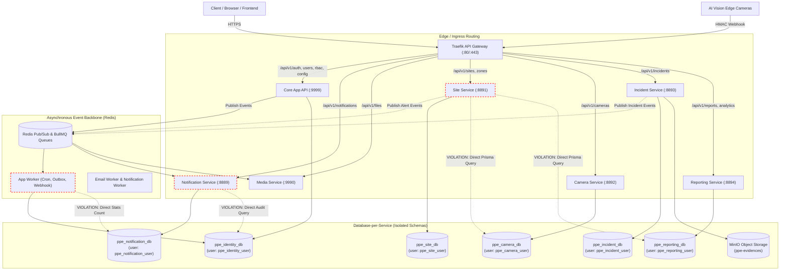

# Module Communication Audit & Monolith-to-Microservices Map

> **Phiên bản:** 1.0.0  
> **Ngày lập:** 12/10/2026  
> **Mục tiêu:** Khảo sát toàn diện source code thực tế của repository `smart-ppe-monitoring-microservices`, lập bản đồ giao tiếp giữa các module/service, phát hiện các điểm vi phạm ranh giới kiến trúc, và vạch ra lộ trình chuẩn hóa.

---

## 1. Tổng quan Kiến trúc Hiện tại

Dự án đang trong quá trình chuyển đổi từ **Monolith** sang **Microservices (Database-per-Service)**. Hệ thống hiện có:
- **09 Entry Points / Service Processes riêng biệt:**
  1. `src/server.ts`: Monolith Server toàn năng (`PORT=9999`)
  2. `src/api.server.ts`: Decoupled Core API Gateway/Backend (`PORT=9999`)
  3. `src/worker.server.ts`: Background Worker Process (BullMQ queues: cron, webhook, email, outbox, event-bus)
  4. `src/site.server.ts`: Site & Zone Microservice (`PORT=8891`)
  5. `src/camera.server.ts`: Camera & Stream Management Microservice (`PORT=8892`)
  6. `src/incident.server.ts`: Incident & Violation Review Microservice (`PORT=8893`)
  7. `src/notification.server.ts`: Notification & Realtime SSE Microservice (`PORT=8889`)
  8. `src/media.server.ts`: Media, Storage & Image Processing Microservice (`PORT=8890`)
  9. `src/reporting.server.ts`: Reporting, Analytics & AI Model Governance Microservice (`PORT=8894`)
- **API Gateway Layer:** Traefik v3.1 (`traefik/dynamic.yml` & `docker-compose.yml`) điều phối routing, rate limiting, request ID injection, và internal gateway secret validation (`x-gateway-secret`).
- **Database Architecture:** 6 PostgreSQL logical databases phân lập với 6 user accounts riêng biệt (`init-multiple-dbs.sql`).

---

## 2. Module Communication Matrix

Bảng đối chiếu toàn bộ các kênh giao tiếp giữa các domain modules và microservices dựa trên mã nguồn thực tế:

| Source Module/Service | Target Module/Service | Business Purpose | Current Mechanism | Data Exchanged | Database Ownership | Failure Handling | Current Status | Required Action |
|---|---|---|---|---|---|---|---|---|
| **API Gateway (Traefik)** | `app-api` (`:9999`) | Điều phối auth, rbac, user, config, integration | HTTP Reverse Proxy | HTTP Requests / JSON Responses | `ppe_identity_db` | Traefik retry, health check `/api/v1/health` | Hoạt động | Giữ nguyên |
| **API Gateway (Traefik)** | `notification-service` (`:8889`) | Định tuyến `/api/v1/notifications` | HTTP Reverse Proxy (Priority 100) | HTTP Requests / SSE stream | `ppe_notification_db` | Traefik health check `/health` | Hoạt động | Giữ nguyên |
| **API Gateway (Traefik)** | `media-service` (`:8890`) | Định tuyến `/api/v1/files` | HTTP Reverse Proxy (Priority 100) | Multipart upload / Stream | File Storage + `ppe_identity_db` (`file_records`) | Health check `/health` | Phụ thuộc Monolith DB | Tách schema sang `ppe_media_db` |
| **API Gateway (Traefik)** | `site-service` (`:8891`) | Định tuyến `/api/v1/sites`, `/api/v1/zones` | HTTP Reverse Proxy (Dynamic File) | HTTP Requests / JSON | `ppe_site_db` | Health check `/health` | Hoạt động | Bổ sung container trong Docker Compose |
| **API Gateway (Traefik)** | `camera-service` (`:8892`) | Định tuyến `/api/v1/cameras` | HTTP Reverse Proxy (Dynamic File) | HTTP Requests / JSON | `ppe_camera_db` | Health check `/health` | Hoạt động | Bổ sung container trong Docker Compose |
| **API Gateway (Traefik)** | `incident-service` (`:8893`) | Định tuyến `/api/v1/incidents` | HTTP Reverse Proxy (Dynamic File) | HTTP Requests / JSON | `ppe_incident_db` | Health check `/health` | Hoạt động | Bổ sung container trong Docker Compose |
| **API Gateway (Traefik)** | `reporting-service` (`:8894`) | Định tuyến `/api/v1/reports`, `/api/v1/analytics` | HTTP Reverse Proxy (Dynamic File) | HTTP Requests / JSON | `ppe_reporting_db` | Health check `/health` | Hoạt động | Bổ sung container trong Docker Compose |
| `ai-vision.controller` | `incident-service` / EventBus | Tiếp nhận alert từ AI Camera Edge | HTTP Inbound Webhook (`/api/v1/integrations/ai-vision/alerts`) | JSON payload (HMAC signed) | Nhận tại Integration (`identity_db`), phát event sang bus | Idempotency token (Redis 24h), Retry 3 lần | Hoạt động | Chuẩn hóa Transactional Outbox |
| `ppe-violation.subscriber` | `IncidentRepository`, `NotificationService`, `ReportingRepository` | Xử lý event `ppe.violation.detected` | Direct internal function call / repo instantiations | Event payload (`PPEViolationDetectedPayload`) | Vi phạm: Gọi trực tiếp repo của 3 service khác | In-memory try/catch | Phụ thuộc Monolith | Chuyển sang độc lập Event Consumer |
| `SafetyRuleRepository` (`site-service`) | `ppe_camera_db`, `ppe_reporting_db`, `ppe_identity_db` | Đọc ghi config an toàn PPE đa tầng | Direct Prisma Client cross-import (`sitePrisma`, `cameraPrisma`, `reportingPrisma`, `rbacRepo`) | Entity models | Vi phạm nghiêm trọng Database-per-Service | Try/catch, fallback null | Lỗi kiến trúc P1 | Refactor thành Inter-service HTTP Client |
| `NotificationRepository` | `ppe_identity_db` (`audit_logs`) | Ghi log khi tạo/sửa/xóa template | Direct `identityPrisma.auditLog.create` | Audit log record | Vi phạm Database-per-Service | Catch log warn | Lỗi kiến trúc P1 | Chuyển sang EventBus audit event |
| `NotificationService` | `UserRepository` (`ppe_identity_db`) | Tra cứu danh sách cán bộ an toàn và email | Direct function call `userRepo.findActiveUsersByIds` | User entities (`id`, `email`) | Vi phạm Database-per-Service | Fallback mảng rỗng | Lỗi kiến trúc P1 | Tích hợp Identity Internal API hoặc Event Cache |
| `CronRepository` | `ppe_notification_db` | Thống kê số lượng notifications & emails | Direct `notificationPrisma.count` trong `getActivityStats` | Aggregation count | Vi phạm Database-per-Service | Catch log fallback 0 | Lỗi kiến trúc P2 | Chuyển sang HTTP stats endpoint |
| Satellite Services (`*app.ts`) | `MaintenanceRepository` (`identity_db`) | Kiểm tra trạng thái bảo trì hệ thống | Middleware `maintenanceGuard` -> `maintenanceCacheService` | MaintenanceConfig | Phụ thuộc gián tiếp `ppe_identity_db` | Redis Pub/Sub invalidation; crash nếu DB down | Lỗi kiến trúc P1 | Fallback an toàn khi identity DB không kết nối |
| Satellite Services (`*app.ts`) | `UserRepository` (`identity_db`) | Xác thực user active/deleted | Middleware `authMiddleware` -> `permissionCacheService.getUserState` | CachedUserState | Phụ thuộc gián tiếp `ppe_identity_db` | Trả 401 nếu DB down | Lỗi kiến trúc P1 | Dùng `verifyJwtLocally` (JWKS/Public Key) |
| `integration.service` | External Webhook URLs | Gửi thông báo sự cố ra ngoài (Outbound) | BullMQ Queue `webhook.queue.ts` -> `webhook.worker.ts` | Signed JSON (HMAC SHA-256) | `ppe_identity_db` (`webhook_deliveries`) | Exponential backoff (5 retries) | Hoạt động | Giữ nguyên |

---

## 3. Sơ đồ Giao tiếp Tổng thể (Mermaid Architecture)



---

## 4. Các Dependency Còn Sót từ Monolith

### 4.1. `src/modules/safety-rule/safety-rule.repository.ts`
- **Vấn đề:** File này được import vào `site.app.ts` (thuộc Site Service). Tuy nhiên, code khởi tạo và truy vấn trực tiếp 3 client database khác:
  ```typescript
  import { sitePrisma } from "../../database/site.client";
  import { cameraPrisma } from "../../database/camera.client";
  import { reportingPrisma } from "../../database/reporting.client";
  import { rbacRepository } from "../rbac/rbac.repository";
  ```
- **Tác động:** Khi chạy `site.server.ts` trong môi trường Docker với thông tin xác thực của `ppe_site_user`, PostgreSQL sẽ từ chối kết nối (`REVOKE CONNECT ON DATABASE ppe_camera_db FROM PUBLIC`). Thao tác tra cứu camera config và AI model version sẽ ném lỗi crash.

### 4.2. `src/modules/notification/notification.repository.ts`
- **Vấn đề:** `NotificationRepository` import `prisma as identityPrisma` để thực thi `identityPrisma.auditLog.create(...)` khi thêm, sửa, xóa notification template.
- **Tác động:** Phá vỡ tính tự quản của Notification Microservice. Nếu không cấu hình `IDENTITY_DATABASE_URL`, chức năng quản lý template bị lỗi.

### 4.3. `src/modules/cron/cron.repository.ts`
- **Vấn đề:** Trong phương thức `getActivityStats(startDate, endDate)`, repo này truy vấn trực tiếp `notificationPrisma.notification.count` và `notificationPrisma.emailNotification.count`.
- **Tác động:** Background worker (sở hữu Identity DB) bị gắn chặt với database của Notification service.

### 4.4. `src/middlewares/maintenance.middleware.ts` & `permission-cache.service.ts`
- **Vấn đề:** Mọi satellite service (`site.app.ts`, `camera.app.ts`, `incident.app.ts`, `notification.app.ts`, `media.app.ts`, `reporting.app.ts`) đều gắn `maintenanceGuard()` và `authMiddleware()`. Cả 2 middleware này đều gọi gián tiếp `maintenanceRepository` và `userRepository` (thuộc Identity DB) khi xảy ra cache miss.
- **Tác động:** Nếu Identity DB bị ngắt kết nối hoặc không được cấu hình cho satellite service, mọi request gửi đến các satellite service đều nhận HTTP 500 hoặc HTTP 401 ngay cả khi bản thân microservice đó đang hoạt động hoàn toàn bình thường.

---

## 5. Kế hoạch Xử lý Chuẩn hóa

1. **Safety Rule Aggregation:**
   - Giữ quyền sở hữu bảng `site_safety_configs` và `restricted_areas` tại `ppe_site_db`.
   - Chuyển việc tra cứu camera override sang gọi HTTP nội bộ đến `camera-service` (`GET /api/v1/cameras/:id/config`) hoặc sử dụng fallback an toàn khi standalone.
   - Chuyển việc tra cứu active AI model version sang gọi HTTP nội bộ đến `reporting-service` (`GET /api/v1/reporting/models/active`) hoặc fallback an toàn.
   - Tách audit log thành event hoặc gọi Identity Audit API.

2. **Notification Service Decoupling:**
   - Loại bỏ import `identityPrisma` trong `notification.repository.ts`.
   - Thay thế việc ghi log trực tiếp bằng ghi nhận vào `notification_logs` nội bộ hoặc phát event qua Redis EventBus.
   - Thêm cơ chế fallback cho `dispatchIncidentNotification` khi không thể tra cứu `userRepository`.

3. **Cron Service Decoupling:**
   - Trong `cron.repository.ts`, đóng gói truy vấn `notificationPrisma` thành optional read interface hoặc lấy số liệu qua thống kê nội bộ mà không làm sập tiến trình nếu không có kết nối `NOTIFICATION_DATABASE_URL`.

4. **Satellite Services Resilience:**
   - Cung cấp cơ chế fallback cho `maintenanceCacheService`: nếu không kết nối được `ppe_identity_db`, trả về cấu hình mặc định (Online/Enabled=false) để không chặn đứng các microservice khác.
   - Trong `permissionCacheService.getUserState()`: nếu chạy ở chế độ standalone hoặc identity DB không kết nối, không ép buộc `return null` mà cho phép xác thực token thông qua chữ ký mật mã RS256/Public Key (`verifyJwtLocally`).
