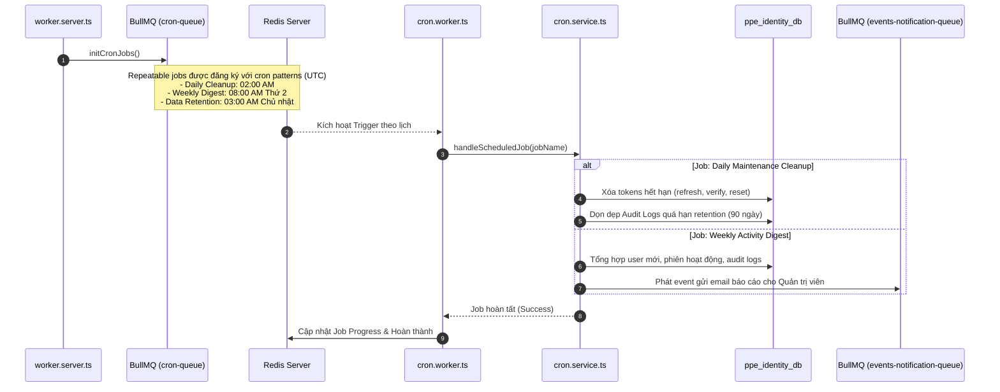
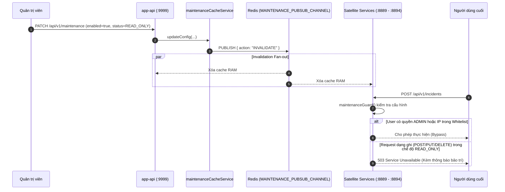
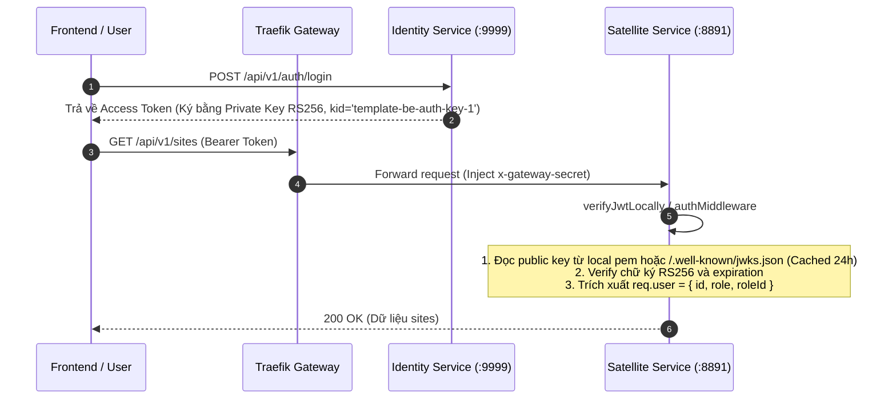
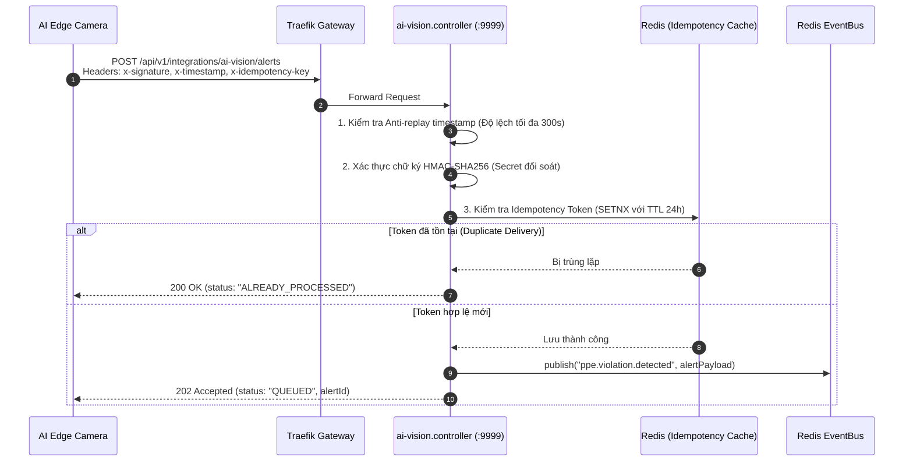
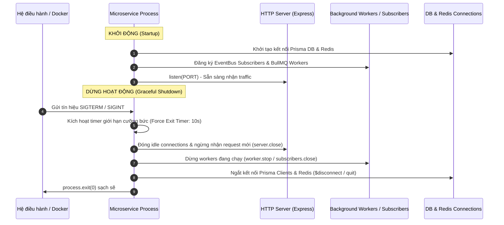

# Runtime Flows & Execution Lifecycles

> **Phiên bản:** 1.0.0  
> **Ngày lập:** 12/10/2026  
> **Mục tiêu:** Mô tả chi tiết luồng thực thi trong thời gian chạy (runtime) cho các module đặc biệt: Cron & Maintenance, Authentication & API Key, Webhooks (Inbound/Outbound), Message Broker và Khởi động/Dừng service (Graceful Shutdown).

---

## 1. Luồng Cron Jobs & Scheduled Tasks

Hệ thống quản lý các tác vụ định kỳ thông qua tiến trình `app-worker` (`src/worker.server.ts`) kết hợp cùng BullMQ queue (`src/modules/cron/cron.queue.ts` & `cron.worker.ts`):

### Các đặc tính an toàn:
1. **Chống thực thi trùng lặp (Concurrency Control):** BullMQ sử dụng Redis repeatable job keys và distributed locks đảm bảo dù `app-worker` có scale nhiều replicas, mỗi scheduled job chỉ được xử lý bởi **đúng một** worker instance tại một thời điểm.
2. **Khả năng chạy lại (Idempotency):** Các tác vụ dọn dẹp token và audit logs sử dụng mệnh đề `DELETE ... WHERE expiresAt < cutoffDate` có tính bất biến/idempotent, có thể chạy lại an toàn nếu worker bị crash giữa chừng.

---

## 2. Luồng Bảo trì Hệ thống (Maintenance Mode)

Trạng thái bảo trì được lưu trữ tại bảng `maintenance_configs` (`ppe_identity_db`) và đồng bộ thời gian thực tới các microservice qua Redis Pub/Sub:

---

## 3. Luồng Xác thực (Authentication) & API Key

### 3.1. Xác thực JWT Người dùng (Decentralized Local Verification)
Hệ thống sử dụng chữ ký bất đối xứng **RS256** (RSA 2048-bit) cho phép các satellite microservice tự xác thực token trong **0.01ms** mà không cần gọi HTTP sang Identity Service:

### 3.2. Xác thực API Key Tích hợp Hệ thống
API Key được sử dụng cho các hệ thống bên ngoài hoặc Camera Edge kết nối trực tiếp:
1. Client gửi header `x-api-key: ak_live_...`.
2. Middleware `apiKeyAuthMiddleware` băm SHA-256 chuỗi key và so khớp với `key_hash` trong `api_keys` (`ppe_identity_db`).
3. Kiểm tra các điều kiện nghiêm ngặt:
   - Trạng thái `status === ACTIVE` và chưa bị thu hồi (`revokedAt === null`).
   - Thời hạn hiệu lực `expiresAt > NOW()`.
   - IP Whitelist (nếu có cấu hình).
   - Scopes / Quyền hạn được cấp phép (ví dụ: `ppe:vision:write`).
   - Rate limit chuyên biệt theo từng key.

---

## 4. Luồng Webhook (Inbound & Outbound)

### 4.1. Inbound Webhook (Tiếp nhận Cảnh báo AI Vision từ Camera Edge)

### 4.2. Outbound Webhook (Bắn Webhook Thông báo Sự cố ra Hệ thống Bên ngoài)
1. Khi có sự cố mức nghiêm trọng `CRITICAL`, `integration.service.ts` tìm kiếm các subscription đăng ký sự kiện `ppe.incident.created`.
2. Gói tin được đưa vào BullMQ `webhook.queue.ts`.
3. `webhook.worker.ts` tiếp nhận và gửi HTTP POST đến URL đích với:
   - Header `X-Webhook-Signature`: Chữ ký HMAC SHA-256 tính từ body và secret subscription.
   - Header `X-Webhook-Event`: Tên sự kiện.
   - Timeout 10 giây.
4. Nếu thất bại (timeout hoặc HTTP 5xx), BullMQ kích hoạt cơ chế retry tự động theo hàm mũ (Exponential Backoff) tối đa 5 lần. Kết quả từng lần gửi được ghi nhận vào `webhook_deliveries` (`ppe_identity_db`).

---

## 5. Luồng Khởi động Service & Graceful Shutdown

Tất cả các entry point của hệ thống (`api.server.ts`, `worker.server.ts`, `notification.server.ts`, v.v.) đều tuân thủ quy trình vòng đời chuẩn:

