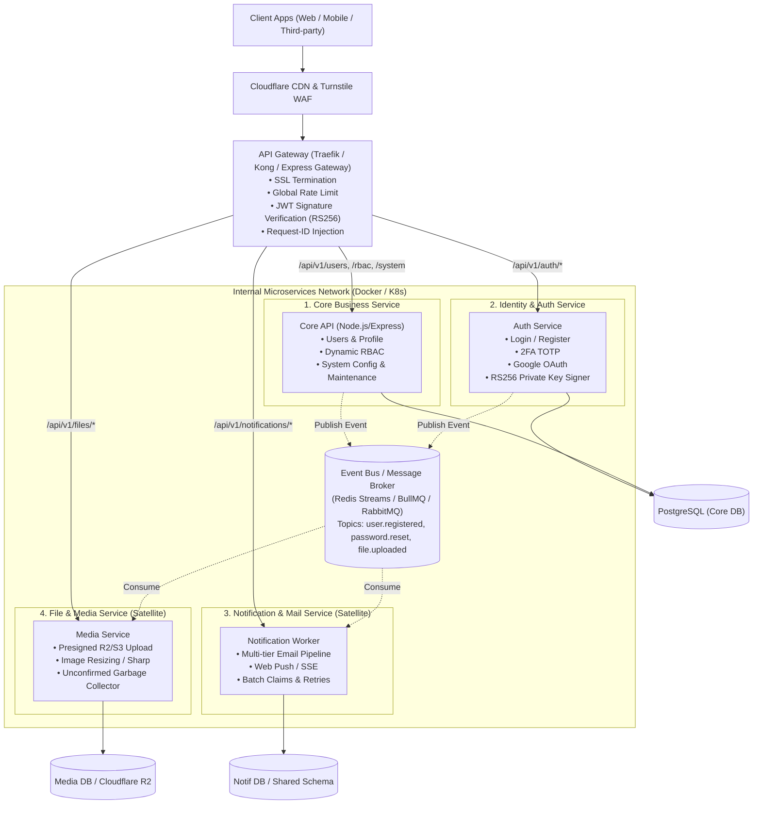

# Lộ trình Chuyển đổi Kiến trúc: Modular Monolith sang Microservices

> **Dự án**: `template-be` (Node.js, Express, TypeScript, Prisma, PostgreSQL, Redis)  
> **Phương pháp luận**: Strangler Fig Pattern (Chuyển dịch dần dần không gián đoạn hệ thống)  
> **Nguyên tắc cốt lõi**: _"Tiến hóa kiến trúc (Evolutionary Architecture) — Tách Process trước, Tách Event sau, Tách Service vệ tinh trước, Tách Database sau cùng."_

---

## 1. Mục tiêu kiến trúc (Goal Description)

Hiện tại `template-be` là một **Modular Monolith** có cấu trúc phân tầng sạch (`route -> validation -> controller -> service -> repository`) với 10 modules độc lập.

Lộ trình này vạch ra kế hoạch từng bước để chuyển đổi dự án sang hệ sinh thái **Microservices** mà không làm gián đoạn nghiệp vụ đang chạy, không làm phát sinh rủi ro mất mát dữ liệu và giữ độ phức tạp vận hành ở mức kiểm soát được.

### Sơ đồ Kiến trúc Đích (Target Architecture)



---

## 2. Các giai đoạn triển khai (Phased Roadmap)

### 📌 Giai đoạn 1: Phân tách Tiến trình (Process Decoupling) & Containerization

> **Thời gian dự kiến**: 1 tuần | **Rủi ro**: Rất thấp | **Đổi code**: < 5%

Tách việc nhận HTTP Request và việc cày tác vụ nặng ngầm (Background Worker) thành 2 tiến trình độc lập từ cùng một source code.

```text
               ┌──> [Container 1: Web API] ───> Nhận HTTP Request (Port 8888)
template-be ───┤
               └──> [Container 2: Worker]   ───> Lắng nghe BullMQ (Email, Webhook, Cron)
```

#### Các đầu việc kỹ thuật:

1. **Tách Entry Point**:
   - Tạo `src/api.server.ts`: Chỉ khởi động Express HTTP server, Swagger docs, health routes.
   - Tạo `src/worker.server.ts`: Chỉ khởi động `emailWorker`, `webhookWorker`, `cronWorker`.
   - Giữ `src/server.ts` làm monolith runner cho local development.
2. **Docker Compose Multi-Container**:
   - Cập nhật `docker-compose.yml` định nghĩa 2 services: `app-api` và `app-worker` dùng chung Docker image nhưng khác lệnh `CMD`.
3. **Mục tiêu đạt được**: Khi có 50.000 user ồ ạt gửi email hoặc webhook tải cao, `app-worker` chạy hết công suất mà **không làm chậm 1ms nào của `app-api`**.

---

### 📌 Giai đoạn 2: Bất đồng bộ hóa qua Khóa Bất Đối Xứng (Asymmetric JWT - RS256)

> **Thời gian dự kiến**: 1 – 2 tuần | **Rủi ro**: Trung bình | **Đổi code**: Auth module

Triệt tiêu điểm nghẽn lớn nhất của Microservices: **Không để các microservice khác phải gọi HTTP sang Auth Service để verify token**.

#### Các đầu việc kỹ thuật:

1. **Chuyển đổi thuật toán ký JWT**:
   - Chuyển từ HS256 (dùng chung 1 secret key) sang **RS256** (RSA Signature with SHA-256) hoặc **Ed25519**.
   - Auth Service nắm giữ `private.key.pem` để ký Access Token khi login.
2. **Cung cấp JWKS Endpoint (RFC 7517)**:
   - Thêm endpoint công khai `GET /.well-known/jwks.json` trả về Public Key.
3. **Decentralized Verification Middleware**:
   - Viết middleware `verifyJwtLocally`: Tải Public Key từ Auth Service (cache trong RAM 24 giờ), tự verify chữ ký token trong **0.01ms** ngay tại mỗi microservice mà không phát sinh bất kỳ network call nào.

---

### 📌 Giai đoạn 3: Xây dựng Event-Driven Backbone (Xương sống Hướng Sự Kiện) ✅ **[ĐÃ HOÀN THÀNH]**

> **Trạng thái**: Hoàn tất 100% | **Automated Tests**: 15/15 tests passing (459/459 toàn dự án)

Thay thế toàn bộ các lời gọi hàm trực tiếp giữa các module bằng mô hình **Publish/Subscribe**.

#### Bảng hợp đồng sự kiện (Event Contract Matrix):

| Tên Event                       | Nguồn phát (Publisher) | Bên tiêu thụ (Consumer) | Dữ liệu kèm theo (Payload)                 | Trạng thái    |
| :------------------------------ | :--------------------- | :---------------------- | :----------------------------------------- | :------------ |
| `auth.user_registered`          | Auth Module            | Notification Service    | `{ userId, email, fullName, verifyToken }` | ✅ Đã kết nối |
| `auth.password_reset_requested` | Auth Module            | Notification Service    | `{ userId, email, resetToken, ip }`        | ✅ Đã kết nối |
| `auth.new_device_detected`      | Auth Module            | Notification Service    | `{ userId, email, deviceName, ip }`        | ✅ Đã kết nối |
| `user.soft_deleted`             | User Module            | Auth & Storage          | `{ userId, deletedBy, deletedAt }`         | ✅ Đã kết nối |
| `file.uploaded_unconfirmed`     | File Module            | Cron / Cleanup          | `{ fileId, key, bucket, expiresAt }`       | ✅ Đã kết nối |

#### Các thành phần kỹ thuật đã bàn giao:

1. **EventBusService** (`src/common/services/event-bus.service.ts`): Hỗ trợ Pub/Sub, BullMQ / Redis Streams, in-memory queue fallback, Dead-Letter Queue (DLQ), retry exponential backoff và bộ nhớ đệm chống trùng lặp Idempotent Consumer (24h TTL).
2. **Transactional Outbox Pattern**:
   - Model `OutboxEvent` (`outbox_events` table) với UUIDv7 và migration `20261003150000_add_outbox_events`.
   - `OutboxRepository` với `claimPendingEvents()` dùng atomic `FOR UPDATE SKIP LOCKED`.
   - `OutboxWorker` (`src/common/workers/outbox.worker.ts`) quét và relay sự kiện tự động theo chu kỳ.
3. **Subscribers chuyên trách** (`src/common/subscribers/`):
   - `NotificationSubscriber`: Lắng nghe các event Auth để gửi email/thông báo.
   - `AuthCleanupSubscriber`: Lắng nghe `user.soft_deleted` để revoke refresh tokens và xóa cache quyền.
   - `StorageCleanupSubscriber`: Theo dõi unconfirmed upload URLs để phục vụ dọn dẹp file mồ côi.
4. **Tích hợp Server Entry Points**: Đăng ký subscribers và outbox worker tại cả `src/server.ts` và `src/worker.server.ts` kèm cơ chế Graceful Shutdown.
5. **Kiểm thử tự động**: 15 test cases trong `tests/event-driven-backbone-phase3.test.ts` (100% pass).

---

### 📌 Giai đoạn 4: Thiết lập API Gateway & Reverse Proxy

> **Thời gian dự kiến**: 1 tuần | **Rủi ro**: Thấp

Tập trung toàn bộ việc kiểm soát biên giới hệ thống vào một cổng duy nhất trước khi traffic đi vào các Microservice.

#### Các đầu việc kỹ thuật:

1. **Lựa chọn Gateway**: Triển khai **Traefik** hoặc **Nginx** (hoặc Express Gateway).
2. **Trách nhiệm của API Gateway**:
   - Định tuyến: `/api/v1/auth/*` ➔ Auth Service, `/api/v1/files/*` ➔ File Service.
   - SSL/TLS Termination.
   - Global Rate Limiting & Cloudflare Turnstile token validation.
   - Tự động sinh và inject header `X-Request-Id` (UUIDv7) để truy vết phân tán (Distributed Tracing).

---

### 📌 Giai đoạn 5: Bóc tách Microservice đầu tiên — `Notification Service`

> **Thời gian dự kiến**: 2 tuần | **Rủi ro**: Rất thấp (Service vệ tinh)

Bóc tách module [notification](file:///d:/NodeJS/Source/template-be/src/modules/notification/) thành một repository/container độc lập hoàn toàn.

#### Lý do chọn Notification đầu tiên:

- Không chứa logic kinh doanh cốt lõi (Core Business Logic).
- Giao tiếp 100% qua Event Queue (Asynchronous).
- Nếu Notification Service tạm thời bảo trì, toàn bộ hệ thống đăng ký, đặt hàng vẫn hoạt động 100% trơn tru.

#### Các bước bóc tách:

1. Khởi tạo repository `template-notification-service`.
2. Mang toàn bộ code từ `src/modules/notification/`, `src/common/services/mail.service.ts` và `email-template.service.ts` sang service mới.
3. Service mới lắng nghe các topic trên Redis Event Bus (`auth.user_registered`, `auth.password_reset_requested`,...).
4. Xóa bỏ logic gọi trực tiếp trong Monolith; Monolith chỉ publish event vào Redis.

---

### 📌 Giai đoạn 6: Bóc tách Microservice thứ hai — `File & Media Service`

> **Thời gian dự kiến**: 1 – 2 tuần | **Rủi ro**: Thấp

Bóc tách module [files](file:///d:/NodeJS/Source/template-be/src/modules/files/) và tích hợp Cloudflare R2 / S3 thành dịch vụ chuyên biệt.

#### Các bước bóc tách:

1. Tạo `template-media-service`.
2. Đảm nhận: Sinh Presigned Upload URL, xử lý nén/crop ảnh bằng `sharp`, quét dọn file rác (orphan files cleanup cron).
3. Core API chỉ lưu trữ URL hoặc File ID dưới dạng tham chiếu (Reference Key).

---

## 3. Bảng Phân Tích Cơ Sở Dữ Liệu: Tách DB hay Dùng Chung?

| Giai đoạn                     | Mô hình CSDL                                            | Ưu điểm                                                                            | Nhược điểm                                   | Đánh giá                                 |
| :---------------------------- | :------------------------------------------------------ | :--------------------------------------------------------------------------------- | :------------------------------------------- | :--------------------------------------- |
| **Giai đoạn 1 – 4**           | **Shared PostgreSQL Database** (Dùng chung 1 instance)  | • Giữ nguyên ACID transaction<br>• Tốn ít RAM và chi phí<br>• Dễ backup và migrate | Chưa cách ly vật lý                          | 🏆 **BẮT BUỘC Ở GIAI ĐOẠN ĐẦU**          |
| **Giai đoạn 5 – 6**           | **Schema-based Isolation** (`core.*`, `notification.*`) | • Phân ranh giới rõ ràng trong Postgres<br>• Cấm JOIN chéo ở tầng ORM              | Cần cấu hình multi-schema Prisma             | 🥈 **Khuyên dùng khi tách 2-3 services** |
| **Tương lai (Khi scale lớn)** | **Database-per-Service** (Mỗi service 1 DB riêng)       | • Độc lập 100%<br>• Không lo ảnh hưởng tải lẫn nhau                                | Phải dùng Saga Pattern / Outbox cho phân tán | ⚠️ **Chỉ làm khi traffic > 100k DAU**    |

---

## 4. User Review Required (Yêu cầu Người dùng Đánh giá)

> [!IMPORTANT]
> **Quyết định Chiến lược**: Bạn có đồng ý với phương pháp tiếp cận **Strangler Fig Pattern** (tiến hóa từng giai đoạn, giữ Monolith chạy ổn định và tách dần từng service vệ tinh) thay vì đập đi viết lại toàn bộ một lúc không?

> [!NOTE]
> **Yêu cầu Hạ tầng**: Để chạy Microservices từ Giai đoạn 2 trở đi, máy chủ dev/production cần tối thiểu:
>
> - Docker & Docker Compose cài đặt sẵn.
> - 1 Redis instance (v3 trở lên hỗ trợ Streams hoặc BullMQ) — dự án đã có sẵn cấu hình này trong template.

---

## 5. Kế hoạch Kiểm thử & Xác minh (Verification Plan)

Mỗi giai đoạn chuyển đổi đều phải vượt qua bộ tiêu chuẩn kiểm thử khắt khe:

### Automated Tests

1. **Kiểm thử hồi quy Monolith**:
   ```bash
   pnpm test
   pnpm build
   pnpm run lint
   ```
   _Mục tiêu_: Toàn bộ 417 test cases hiện tại của `template-be` tiếp tục pass 100%.
2. **Kiểm thử Asymmetric JWT**:
   - Ký token bằng Private Key tại Auth Service.
   - Giải mã và kiểm tra claim tại service khác bằng Public Key độc lập (offline verification).
3. **Kiểm thử Event Bus / Message Reliability**:
   - Mô phỏng ngắt kết nối Redis / Worker sập đột ngột: Sau khi khởi động lại, worker phải tự động nhận lại các message chưa xử lý (Ack/Nack mechanism).
4. **Kiểm thử Tải (Load Testing với k6 / autocannon)**:
   - Chạy benchmark 2.000 req/s kiểm tra thời gian đáp ứng của API Gateway và độ trễ phân tán (`X-Request-Id`).
